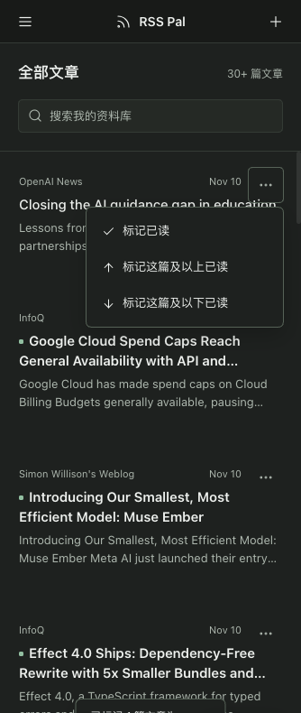

# RSS Pal for DeepSeek Harness

[简体中文](README.md) · **English**

**A local-first reading room inside DSH: RSS subscriptions, full-text search, bulk read marking, on-demand AI summaries and a native reading companion.**

- Repository: <https://github.com/morefreeze/dsh-plugin-rss-pal>
- Plugin package: `rss-pal-dsh` · Version: `0.1.1`
- Marketplace category: **Data & Knowledge (knowledge)**
- License: [MIT](LICENSE)
- A community plugin, not affiliated with DeepSeek AI.

## Features

- RSS / Atom subscription previews, groups, pause/resume, scheduled and manual refresh, and OPML import/export.
- Webpage full-text extraction and refetching, Chinese full-text search, pagination, favorites, tags, likes and dislikes.
- A three-dot menu on each article: mark this article, this article and everything above, or this article and everything below as read. Ranges include the current article and span pages within the current subscription, filter, search and tag scope, while preserving a nearby list anchor.
- Foreground reading time, open counts and progress. Tracking pauses when the window is hidden, loses focus, or receives no activity for 120 seconds.
- On-demand brief summaries and detailed analysis, with templates, streaming background jobs, cached results and stale-summary indicators when article content changes.
- An independently remembered summary-model selection, following the host default initially. Reasoning options reflect the host model's actual capabilities; selecting a summary model does not change the host's global default.
- Native DSH reading companion for whole articles and selected passages, using the host's model picker, composer and conversations.
- URL clipping, Markdown export, local backup/restore, job retry/cancellation and Agent tools.

**Models are called only when you click Generate or explicitly invoke the summary tool.** Opening articles, refreshing feeds and searching do not automatically generate summaries. Ordinary reading requires no model account.

## Screenshot



An actual DSH Web screenshot at mobile width, showing the article action menu. Host conversation lists and account information are excluded.

## Installation

### Install from GitHub — current distribution channel

```sh
dsh plugin --profile web add github:morefreeze/dsh-plugin-rss-pal
```

The repository includes prebuilt `lib/index.js` and `lib/client.js`, so installing the plugin does not require compiling its source. `better-sqlite3` is a native dependency: if the installer requests build approval, approve the native build for that dependency only. Enable **RSS Pal** in the plugin manager and refresh the page. New Host modules require reloading the plugin or the host.

### Install a release package

Download `rss-pal-dsh-0.1.1.tgz` from [GitHub Releases](https://github.com/morefreeze/dsh-plugin-rss-pal/releases):

```sh
dsh plugin --profile web add ./rss-pal-dsh-0.1.1.tgz
```

### Install from npm

`rss-pal-dsh@0.1.0` is published on [npm](https://www.npmjs.com/package/rss-pal-dsh):

```sh
dsh plugin --profile web add rss-pal-dsh
```

The latest GitHub Release is `0.1.1`; npm publication verification for `0.1.1` is pending. Marketplace listings and one-click installation remain subject to each marketplace's checks. New features on GitHub main may precede npm releases; the GitHub install above includes the latest source and committed builds.

## Feedback and public download reports

The sidebar's **反馈与建议 (Feedback)** entry links to [bug reports](https://github.com/morefreeze/dsh-plugin-rss-pal/issues/new?template=bug-report.yml), [feature requests](https://github.com/morefreeze/dsh-plugin-rss-pal/issues/new?template=feature-request.yml) and [existing issues](https://github.com/morefreeze/dsh-plugin-rss-pal/issues). Include plugin/DSH versions, your environment and reproduction steps; redact screenshots and logs. The plugin never uploads diagnostics, subscriptions, articles or conversations automatically.

The [download report](docs/reports/downloads.md) shows npm downloads for the last 30 complete UTC days, GitHub Release asset downloads and stars/forks/issues. GitHub Actions generates it daily and supports manual runs. Failed sources are marked unknown, not zero. **Downloads are not unique users or active users; npm and Release counts must not be added as a user count.** Only the repository-side script queries public statistics; installed plugins remain telemetry-free.

```sh
node scripts/download-report.mjs
```

## Compatibility and runtime requirements

| Item | Requirement / verification scope |
| --- | --- |
| DSH profile | `web` |
| Declared DSH versions | `0.2.1-rc.5`, `0.2.2-rc.1` |
| Runtime-tested environment | macOS, DeepSeek Harness `0.2.1-rc.5` Web |
| Node.js | `>=22.19.0`; the selected DSH release may require a newer version |
| Database | Local SQLite through the `better-sqlite3` native module |
| Other environments | Windows, Linux, Desktop and DSH `0.2.2-rc.1` have not been runtime-tested |

## Permissions, external services and data

- The Host reads and writes the SQLite library and pre-restore backups under `storages/rss-pal-dsh/` in Harness home. Uninstalling the plugin preserves reading data.
- Network access is used for user-added RSS / Atom feeds, webpages and remote images in article content. Full-text extraction depends on the source site's content and access conditions.
- On-demand summarization sends article content to the selected host model. The reading companion uses host conversations and model configuration; model services may incur charges.
- No additional account system, separate model credentials, telemetry or cloud synchronization. The original RSS Pal server, Go, PostgreSQL and Docker are not required.
- Feeds refresh every 60 minutes by default; set the interval to `0` to disable scheduled refresh. Refresh runs only while the host is running. Pausing a subscription preserves its articles.
- Backups contain subscriptions, article content, reading history and summaries, but not host model credentials. Restore validates the input, replaces data transactionally and preserves a pre-restore backup. Running jobs must finish or be cancelled first.

This version does not include personalized recommendations, daily/weekly digests, audio/video subtitles, PDF / OCR, public sharing or a browser extension.

## Agent tools

`rsspal_list_feeds`, `rsspal_list_articles`, `rsspal_read_article`, `rsspal_search`, `rsspal_subscribe`, `rsspal_refresh`, `rsspal_capture`, `rsspal_summarize`, `rsspal_jobs`, `rsspal_set_state`, `rsspal_export_markdown`.

Agent reads do not count toward human reading time. The summary tool should be invoked only when explicitly requested by the user.

## Development and testing

Install development dependencies:

```sh
npm ci --include=dev
```

The `@deepseek-ai` runtime dependencies are provided by DSH. For development, also install the following four packages at the same version as your target DSH release:

```sh
npm install --include=dev --save-dev --package-lock=false \
  @deepseek-ai/dsh-tools@0.2.1-rc.5 \
  @deepseek-ai/dsh-llm@0.2.1-rc.5 \
  @deepseek-ai/dsh-home-paths@0.2.1-rc.5 \
  @deepseek-ai/dsh-typert-protocol@0.2.1-rc.5
npm run check
npm pack
```

`npm run check` performs type checking, Host / Client builds and the full regression suite.

The Host entry is the Cordis `RssPalService` plugin class. The Web Client exports `apply(ctx)` from `src/client/index.tsx`, registering the RSS Pal panel, Remote methods and native companion. The client includes KaTeX styles and fonts, without an additional formula-font service.

## Verification

Current regression baseline: **88 passing tests**, covering transactional read ranges, filter isolation, pagination/filter navigation during pending writes, reading tracking, explicit summary generation and model selection. Desktop and mobile-width layouts, single-article read-state RPC and the native reading companion have been verified in actual DSH Web.

## Acknowledgments

Inspired by RSS Pal. Article extraction and sanitization use Mozilla Readability, DOMPurify and other open-source projects. Dependencies retain their respective licenses.
