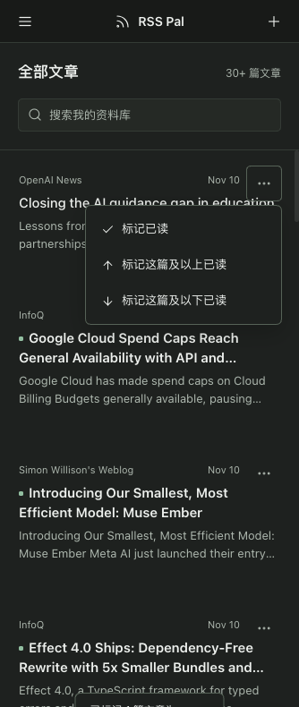

# RSS Pal for DeepSeek Harness

**简体中文** · [English](README.en.md)

**DSH 内的本地 RSS 阅读室：订阅、全文搜索、批量已读、手动 AI 总结与原生伴读。**

A local-first RSS/Atom reader for DeepSeek Harness, with full-text search, on-demand AI summaries and a native reading companion.

- 仓库：<https://github.com/morefreeze/dsh-plugin-rss-pal>
- 插件包名：`rss-pal-dsh` · 版本：`0.1.1`
- 市场能力分类：**Data & Knowledge (knowledge) / 数据与知识**
- 许可证：[MIT](LICENSE)
- 社区插件，与 DeepSeek AI 官方无隶属关系。

## 功能

- RSS / Atom 订阅预览、分组、暂停、定时与手动刷新，OPML 导入导出。
- 网页全文提取与重抓、中文全文搜索、分页、收藏、标签、点赞与不喜欢。
- 每篇文章的三点菜单：标记已读、标记这篇及以上 / 以下已读。范围包含本篇，按当前订阅、筛选、搜索、标签跨分页计算，并保留附近列表锚点。
- 前台活跃阅读时长、次数与进度；隐藏窗口、失焦及连续 120 秒无操作时暂停计时。
- 手动生成简短摘要和详细分析，支持模板、流式后台任务、结果缓存与正文变化标记。
- 总结模型独立选择并记忆，默认跟随宿主；推理强度按宿主真实模型能力显示，不修改宿主全局默认模型。
- 文章与选段接入 DSH 原生伴读，使用原生模型选择、输入框和会话。
- URL 网摘、Markdown 导出、本地备份恢复、任务重试 / 取消及 Agent 工具。

**只有用户点击生成或明确调用总结工具时才调用模型。** 打开文章、刷新订阅和搜索不自动生成总结。普通阅读无需模型账号。

## 截图



实际 DSH Web 手机宽度截图，展示三点菜单；未包含宿主会话列表或账号信息。

## 安装

### 从 GitHub 安装（当前发布渠道）

```sh
dsh plugin --profile web add github:morefreeze/dsh-plugin-rss-pal
```

仓库包含预构建的 `lib/index.js` 和 `lib/client.js`，安装时无需编译插件源码。`better-sqlite3` 是原生依赖；安装器提示构建审批时，只为该依赖允许原生构建。安装完成后在插件管理中启用 **RSS Pal**，刷新页面；新增 Host 模块需重载对应插件或宿主。

### 发布包安装

从 [GitHub Releases](https://github.com/morefreeze/dsh-plugin-rss-pal/releases) 下载 `rss-pal-dsh-0.1.1.tgz`：

```sh
dsh plugin --profile web add ./rss-pal-dsh-0.1.1.tgz
```

### 从 npm 安装

`rss-pal-dsh@0.1.1` 已发布到 [npm](https://www.npmjs.com/package/rss-pal-dsh)：

```sh
dsh plugin --profile web add rss-pal-dsh
```

市场的收录及一键安装状态取决于各市场核验。GitHub main 中的新功能可能先于 npm 发布；上方 GitHub 安装方式可取得最新源码及预构建产物。

## 反馈与公开下载报表

插件侧栏的 **反馈与建议** 提供[问题反馈](https://github.com/morefreeze/dsh-plugin-rss-pal/issues/new?template=bug-report.yml)、[功能建议](https://github.com/morefreeze/dsh-plugin-rss-pal/issues/new?template=feature-request.yml)与[已有反馈](https://github.com/morefreeze/dsh-plugin-rss-pal/issues)。请注明插件/DSH 版本、系统与复现步骤，并对截图和日志脱敏；插件不会自动上传诊断、订阅、文章或聊天。

[下载统计报表](docs/reports/downloads.md)展示最近 30 个完整 UTC 日的 npm 下载趋势、GitHub Release 文件下载及 Star/Fork/Issue。GitHub Actions 每天生成，也支持手动触发；来源失败会标明未知，不填成 0。**下载次数不代表独立用户或活跃人数，npm 与 Release 不相加当人数。** 仅仓库侧脚本访问公开统计接口，用户安装的插件保持无遥测。

```sh
node scripts/download-report.mjs
```

## 兼容与运行要求

| 项目 | 要求 / 验证范围 |
| --- | --- |
| DSH profile | `web` |
| DSH 版本声明 | `0.2.1-rc.5`、`0.2.2-rc.1` |
| 实机验收 | macOS、DeepSeek Harness `0.2.1-rc.5` Web |
| Node.js | `>=22.19.0`；使用的 DSH 版本可能要求更高版本 |
| 数据库 | 本地 SQLite / `better-sqlite3` 原生模块 |
| 其他平台 | Windows、Linux、Desktop 和 `0.2.2-rc.1` 尚未实机验收 |

## 权限、外部服务与数据

- Host 读写 Harness home 下 `storages/rss-pal-dsh/` 的 SQLite 资料库与恢复前备份；卸载插件保留阅读数据。
- 网络访问用户添加的 RSS / Atom 源、网页及正文中的远程图片；全文提取取决于目标网页的内容和访问条件。
- 手动总结将文章内容发送到用户选择的宿主模型；伴读使用宿主会话和模型配置，模型服务可能计费。
- 不新增账号系统、独立模型凭据、遥测或云端同步；无需原 RSS Pal 服务、Go、PostgreSQL 或 Docker。
- 默认 60 分钟刷新，设为 `0` 可关闭；仅在宿主运行时执行，暂停订阅保留文章。
- 备份包含订阅、正文、阅读历史和总结，不包含宿主模型凭据。恢复校验输入并事务替换，保留恢复前备份；运行任务需先结束或取消。

当前版本不含兴趣推荐、日报周报、音视频字幕、PDF / OCR、公开分享或浏览器扩展。

## Agent 工具

`rsspal_list_feeds`、`rsspal_list_articles`、`rsspal_read_article`、`rsspal_search`、`rsspal_subscribe`、`rsspal_refresh`、`rsspal_capture`、`rsspal_summarize`、`rsspal_jobs`、`rsspal_set_state`、`rsspal_export_markdown`。

Agent 阅读不会计入人类阅读时长。总结工具只在用户明确要求时调用。

## 开发与测试

先安装开发依赖：

```sh
npm ci --include=dev
```

宿主 `@deepseek-ai` 依赖由 DSH 提供，开发时还需在当前项目安装与目标 DSH 同版的 `dsh-tools`、`dsh-llm`、`dsh-home-paths`、`dsh-typert-protocol` 四个包：

```sh
npm install --include=dev --save-dev --package-lock=false \
  @deepseek-ai/dsh-tools@0.2.1-rc.5 \
  @deepseek-ai/dsh-llm@0.2.1-rc.5 \
  @deepseek-ai/dsh-home-paths@0.2.1-rc.5 \
  @deepseek-ai/dsh-typert-protocol@0.2.1-rc.5
npm run check
npm pack
```

`npm run check` 执行类型检查、Host / Client 构建与全部回归测试。

Host 入口为 Cordis `RssPalService` 插件类；Web Client 在 `src/client/index.tsx` 导出 `apply(ctx)`，注册 RSS Pal 面板、Remote 与原生伴读。客户端包含 KaTeX 样式与字体，无需额外公式字体服务。

## 验证

当前回归：**88 项通过**，包括事务范围已读、筛选隔离、待写入期间翻页 / 切筛选竞态、阅读追踪、手动总结与模型选择。已在真实 DSH Web 验证桌面和手机布局、单篇已读 RPC 与原生伴读。

## 致谢

产品灵感来自 RSS Pal；正文提取与清洗使用 Mozilla Readability、DOMPurify 等开源项目。依赖各自遵循其许可证。
